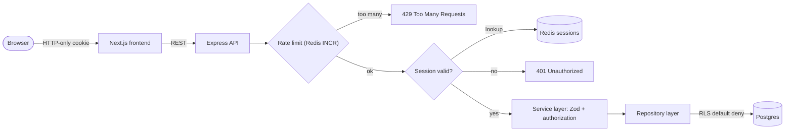

  

  

  
  
  
  

---

### 👋 Hey there

I build web applications end to end, from the database schema to the last pixel, and I've been doing it for clients since **2021**.
What I enjoy most is the part users never see: **who is allowed to read which row**, how a session dies when it should,
and what happens when someone sends the same request 500 times.

> 🟢 **Open to Junior Full Stack · backend (Node.js) · frontend (React) roles, in Istanbul or remote.**

---

### 🚀 Selected work

<table>
  <tr>
    <td width="50%" valign="top">
      <h3><a href="https://sporliyo.com">⚽ Sporliyo</a></h3>
      
      
      
SaaS for football academies. Admins, coaches and parents each get their own dashboard for students, groups, training sessions, attendance, dues and CSV reports. Data is filtered on the server by role, so each user only loads what their role is allowed to see.

      <b>Next.js 16 · React 19 · Neon Postgres · Zod · Vercel Blob</b>
    </td>
    <td width="50%" valign="top">
      <h3><a href="https://github.com/MelihIlker/Solopreneur">🔐 Solopreneur</a></h3>
      
      
      
Client and project management, built security-first. It uses Redis-backed sessions instead of stateless JWT (revoking one takes effect instantly on every device), Postgres RLS with default deny, Argon2 hashing, and CI on GitHub Actions.

      <b>Express · Next.js · Supabase · Redis · Docker Compose</b>
    </td>
  </tr>
  <tr>
    <td width="50%" valign="top">
      <h3>🎮 NullSect Development</h3>
      
      
      
Multiplayer game-server plugins that a partner and I build end to end, from Lua server logic to React + TypeScript interfaces and MySQL persistence.

      <b>Lua · React · TypeScript · MySQL</b>
    </td>
    <td width="50%" valign="top">
      <h3><a href="https://github.com/MelihIlker/portfolio">🌐 Portfolio</a></h3>
      
      
      
A bilingual personal site, prerendered to static HTML with a custom SSR script. It has its own URL per language, generated SEO (Open Graph, JSON-LD, sitemap) and full reduced-motion support.

      <b>React 19 · TypeScript · Tailwind CSS v4 · Vite</b>
    </td>
  </tr>
</table>

  
<b>🔍 Peek inside: how a request moves through Solopreneur</b>

   

The frontend never talks to the database. Every row is protected by Row Level Security, and every session can be killed server-side.

---

### 🧰 Tech I work with

   
   
  

---

  
<b>📜 Experience timeline</b>

   

| When | What | Highlights |
|---|---|---|
| **2021 → now** | Freelance full stack developer | Client web apps end to end · REST APIs with JWT, RBAC, Redis rate limiting · Amazon S3 (presigned URLs, IAM) |
| **Oct 2025 → Mar 2026** | WestLA Online | Community platform with real-time notifications and an admin panel · reached **100+ daily active users** |
| **Sep 2023 → Jun 2024** | Panasonic Electric Works Turkey | Full stack software developer intern · C# / ASP.NET MVC admin panel · real-time IT dashboard |
| **2025 → 2027** | Bandırma Onyedi Eylül University | Associate degree, Computer Programming |

  
<b>🛡️ Things I care about when I build</b>

   

- **Access control first.** RBAC and row-level rules are designed before the first endpoint.
- **Revocable sessions.** If a session can't be killed from the server, it isn't really under control.
- **Validate at the edge.** Every input goes through a schema (Zod) before it reaches business logic.
- **Boring, typed code.** TypeScript end to end, clear layers, nothing clever that the next person has to decode.

  

